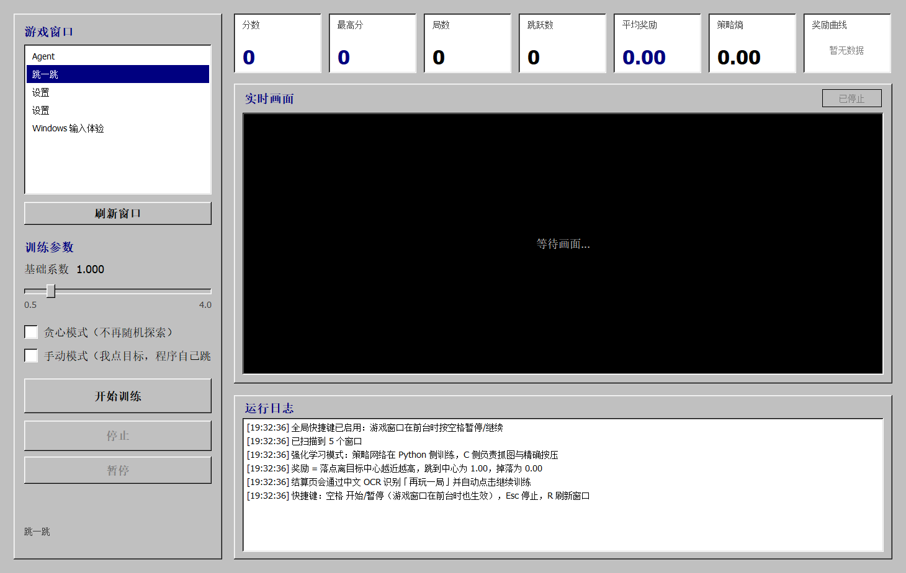

# 微信跳一跳 PC 端 · 强化学习训练台

> 在电脑微信里打开跳一跳，程序自己跳、自己学、输了自动重开下一把。

作者：**大p3**（原始经典版）；强化学习版由本仓库重写。



---

## 它能做什么

- 直接抓取真实微信小程序窗口画面，不依赖屏幕截图
- 用项目原有的视觉算法定位棋子和目标方块
- 由策略网络决定按压时长，落点离方砖中心越近奖励越高
- 每跳都从落点偏差学习一次，模型保存到 `ml_model.json`，下次启动继续训练
- 结算页用 Windows 内置中文 OCR 识别「再玩一局」并自动点击，进入下一局继续学习
- 排行榜、福利页等非游戏页面会自动点返回，不会乱点
- 全中文经典 Win32 复古界面，实时显示识别标注、奖励曲线、局数与跳跃数

---

## 运行环境

| 项目 | 要求 |
| --- | --- |
| 系统 | Windows 10 / 11 |
| Python | 3.13（只负责视觉与策略推理） |
| 电脑微信 | 能打开「跳一跳」小程序 |
| 系统语言包 | 中文（用于 OCR 识别结算页汉字） |
| 编译器 | MinGW gcc（仅重新编译界面时需要，仓库已带 `jump_rl.exe`） |

仓库不包含 `.venv`，首次使用先装依赖：

```
py -3.13 -m venv .venv
.venv\Scripts\python.exe -m pip install -r requirements.txt
```

或者双击 `setup.bat` 自动完成。

---

## 启动

双击桌面上的「微信跳一跳训练台」快捷方式，或运行：

```
native\build\jump_rl.exe
```

界面是纯 C 写的 Win32 API 程序（经典灰底 3D 凹凸控件），编译时链接 `-mwindows`，运行不会出现黑色控制台。抓图、按压、窗口枚举、鼠标与键盘全局钩子都在 C 侧完成；只有视觉识别和策略网络交给隐藏的 `.venv\Scripts\pythonw.exe` 子进程，C 与 Python 之间只传 JSON 协议行和帧文件。

---

## 使用步骤

1. 在电脑微信里打开「跳一跳」，进入可以玩的画面
2. 在左侧窗口列表里选中标题带「跳一跳」的窗口
3. 点「开始训练」，或按空格键
4. 右侧预览区会显示识别结果，底部日志会显示每一跳的偏差与奖励
5. 按空格暂停，按 Esc 停止

快捷键：空格 开始/暂停，Esc 停止，R 刷新窗口。

---

## 奖励与学习

| 情况 | 奖励 |
| --- | --- |
| 落点在方砖中心 | 接近 1.00 |
| 偏离中心越远 | 越低 |
| 掉下去 / 结算页 | 0.00 |

分数直接读游戏左上角的显示：每跳落地后按模板逐位识别数字并拼接，识别不出时才回退「普通落地 +1、中心连击 2/4/6/…」的估算（日志会标「估算+N」）。

策略网络是 `ml/policy.py` 里的 numpy 小型网络：输入 10 个特征，隐层 24 个单元，输出 11 个按压系数（0.90 ~ 1.10 倍，步长 0.02），用 REINFORCE 在线更新，并带奖励基线与熵正则。全部参数只有 539 个，模型文件 14KB，前向计算不到 1ms。

当前策略处于**解冻**状态（`FREEZE_POLICY = False`），会继续在线更新。实测收敛后熵降到 0.2 左右，动作稳定在 1.00 倍档。

- 按压系数写死为 **2.17ms/像素**（用「帧对齐投影」测出的真实落点反解后微调，按默认窗口标定，运行中不再自适应）
- 落点判定用**帧对齐投影**：把起跳前的目标方块位置，按两帧之间的画面位移投影到落点画面，再和棋子比较，不再依赖方块轮廓测量
- 目标选择会排除棋子脚下的方块（顶面与棋子底面同高，且水平范围盖住棋子），向下跳的方块也能正确识别
- 目标选择用**上一跳的方块框**做排除：把上一跳的目标框按画面位移投影到当前帧，和它重叠的候选直接跳过；只按「离棋子远近」判断新方块，近方块和同高度方块也能选中
- 方块侧面被 YOLO 单独框出来时，会先沿颜色把框向上扩展到顶面，再检查框顶上方是否是背景；顶面不像顶面的候选降低置信度，转人工修正
- 目标点不再搜索白色亮斑，改为按方块行宽几何计算顶面中心，侧面上的白点/花纹不会再把落点带偏
- 识别优先用 `models/yolo_jump.pt`（YOLOv8 棋子/方块检测，CPU 约 40ms/帧），检测不到时回退传统 CV
- 按压时长硬性限制在 140ms ~ 1150ms
- 识别置信度过低、距离异常、画面不是跳一跳窗口时，一律不点击；置信度低于 0.65 或找不到目标时会暂停并请你人工点一下目标中心，详见下面「低可信度人工修正」
- 画面连续多帧完全不变时会放宽门槛继续尝试，避免卡死
- 学习结果每跳保存，支持续训；删除 `ml_model.json` 可清空重学

---

## 低可信度人工修正

自动模式下，如果 YOLO 给出的置信度低于 **0.65**，或者只找到棋子找不到目标方块，程序不会硬跳，而是停下来：

1. 预览区和左下角提示「识别可信度低：请在游戏画面上点击目标方块中心」，状态显示「待修正」
2. 你在游戏画面里点一下目标方块的中心，这一下点击会被程序拦截，游戏不会收到
3. 程序立刻按你的点击位置计算距离并起跳，这一跳不更新策略网络
4. 同时把点击位置周围的画面梯度特征存进 `ml/vision_calib.npz`，以后识别时会拿这些人工样本做模板匹配：如果当前选中目标和历史修正样本差得远、而画面别处有更像的目标，就改选更像的那个；万一 YOLO 完全没给出目标，也会用样本直接在画面里定位

修正样本最多保留 60 个，越新的越优先。手动模式不会触发这套流程。

---

## 特殊方块加分

跳到下列方块上停留约 2 秒会额外加分，程序会自动识别并等待：

| 方块 | 加分 | 特征 |
| --- | --- | --- |
| 黑胶唱片 / 音乐盒 | +30 | 整块深黑，停留播放音乐 |
| 徐记士多 / 便利店 | +15 | 亮白店面，停留等开门 |
| 魔方 | +10 | 高饱和多色，停留等旋转 |
| 井盖 | +5 | 中暗灰圆盖，停留等冲水 |

连续命中方块中心还有连击奖励：2、4、6、8、10、12… 逐次递增。程序优先读游戏左上角分数，用「本次增量 ≥ 2」直接判定中心命中；读不出分数时才回退按像素偏差计算奖励。

---

## 参数

**基础系数**：按压时长的整体基准，默认 1.000。策略网络在这个基准上做 0.90 ~ 1.10 倍的调整。换窗口尺寸或微信缩放改了导致老是跳短/跳飞时，调这个滑块即可，不用改代码。

**贪心模式**：勾选后不再随机探索，直接选当前最优动作，适合训练稳定后刷分。

**手动模式**：勾选后程序不再自己跳。每轮它会自动识别下一个方块并把**鼠标光标移到预测的目标点**（不点击）：预测对了你直接点一下就跳；不对就把光标移到正确位置再点。按压发生在鼠标当前位置（光标不会被移走），时长 = 2.17ms/像素 × 距离 × 基础系数。你发出的点击会被程序拦截，游戏不会收到，所以不会误触；程序跳跃期间（按压/结算处理中）的点击会被丢弃，不会排队。手动模式不更新策略网络。

**低可信度修正**：自动模式下置信度低于 0.65 或找不到目标时，状态会变成「待修正」，请在游戏画面上点一下目标方块中心，程序会用这个点起跳并把它记成修正样本。阈值写在 `ml/worker.py` 的 `ASK_CONF`。

---

## 项目结构

```
wechat-jump-pc/
├── native/
│   ├── app.h            # C 侧共享结构体与全局状态声明
│   ├── gui.c            # Win32 经典界面：窗口列表、预览、日志、统计、鼠标/键盘钩子
│   ├── core.c           # PrintWindow 抓图、精确按压、帧文件与 JSON 管道、引擎线程
│   └── build/jump_rl.exe
├── ml/
│   ├── worker.py        # 推理主循环：识别 → 决策 → 反馈 → 学习 → 自动重开
│   ├── yolo_vision.py   # YOLO + 传统 CV 融合，对比上一帧与背景挑出新方块
│   ├── correct.py       # 人工修正样本：梯度模板的保存、评分与全图定位
│   ├── policy.py        # numpy 策略网络（REINFORCE + 续训）
│   ├── landing.py       # 落点方砖检测、帧对齐投影与奖励计算
│   ├── ocr.py           # Windows 中文 OCR，结算/排行榜页面判定
│   └── selftest.py      # 离线自测（不碰真实鼠标）
├── ai_vision.py         # 视觉识别（原项目算法保留）
├── ai_control.py        # 抓图工具（ai_vision 采样用）
├── common/pc_control.py # 窗口枚举与截图工具
├── ml_model.json        # 学习结果（自动生成）
├── ml/vision_calib.npz  # 人工修正样本（自动生成）
└── logs/                # 运行日志与识别失败样本
```

---

## 自测

```
.venv\Scripts\python.exe ml\selftest.py
```

覆盖四部分：策略网络在模拟环境里是否收敛并能续训、视觉识别是否正常、修正样本的评分与定位、引擎的请求/响应流程（含手动模式与人工修正点击）与自动重开是否跑通。

---

## 常见问题

**Q: 启动后一直「等待有效画面」？**

确认选中的窗口是跳一跳小程序本体，并且没有被最小化；日志里会显示具体原因（识别失败 / 置信度过低 / 距离异常）。

**Q: 结算页不自动重开？**

日志会显示 OCR 识别到的文字。若提示「结算页等待按钮」，说明当前页面没有可点击按钮，程序会继续等待，不会乱点。

**Q: 想重新训练？**

删除 `ml_model.json` 后重启程序。想连人工修正记录一起清掉，再删除 `ml/vision_calib.npz`。

**Q: 改了代码要重新编译？**

界面是 C，改 `native` 里的文件后需要重新编译（图标资源也要一起编进去）：

```
windres native\app.rc -I native -O coff -o native\build\app.res
gcc -O2 -o native\build\jump_rl.exe native\build\app.res native\gui.c native\core.c -luser32 -lgdi32 -lwinmm -lm -mwindows
```

只改 `ml/` 里的 Python 逻辑不用编译，关掉程序重新打开即可。

---

## 致谢

- 棋子/方块检测模型 `models/yolo_jump.pt` 来自 [Qiyao-sudo/Yolo-Jump-Cheat](https://github.com/Qiyao-sudo/Yolo-Jump-Cheat)，基于 YOLOv8 训练
- 推理使用 [Ultralytics](https://github.com/ultralytics/ultralytics)
- 项目原始视觉识别算法与界面思路

---

## 免责声明

仅供学习交流与强化学习算法实验，请勿用于任何商业用途或刷分牟利。自动化操作微信小程序可能违反其用户协议，使用导致的账号风险由使用者自行承担。请优先在自己可控的环境中运行。

---

## License

本项目基于 **GNU Affero General Public License v3.0** 开源，完整协议见 [LICENSE](LICENSE)。

因为依赖 Ultralytics（YOLOv8，AGPL-3.0）并附带其训练的权重文件，所以采用同协议发布。若你要在自己项目里使用本仓库代码，需同样以 AGPL-3.0 开源。

